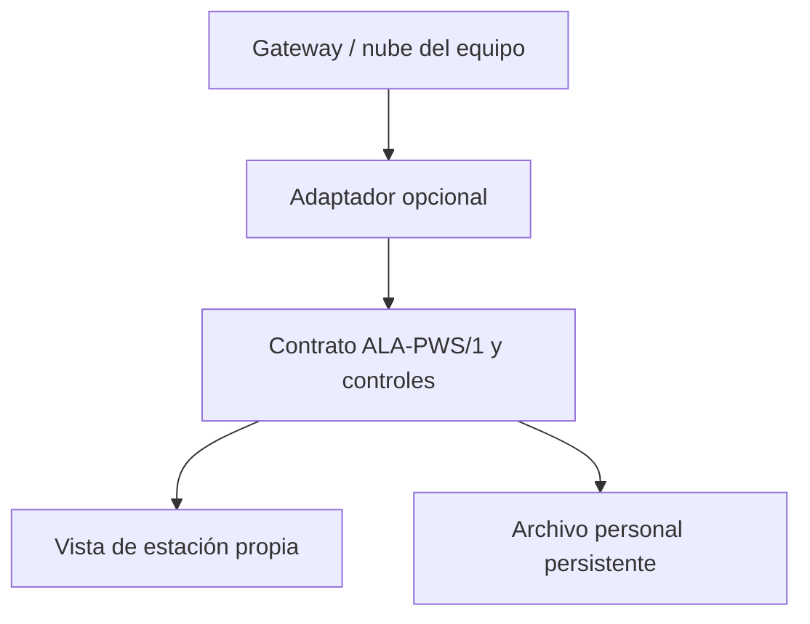

# Estación propia para ALA: compra e integración opcional

Investigación iniciada el 19/10/2026; revisión de compatibilidad del 20/10/2026.
Base final revisada: `dabeb8f4a2d08c093a53b5b1a8bd13ccd4e16c34` (V4.10.3).
Presupuesto del usuario: USD 300–600; emplazamiento previsto: terraza, todavía sin relevamiento.

## Recomendación de compra

**Elegiría Ecowitt GW3001 (GW3000 + WS90) y agregaría el pluviómetro WH40H.**
El conjunto cotizado en la tienda del fabricante suma **USD 244,98**, antes de envío,
importación y montaje. Deja margen dentro del presupuesto para instalación, respaldo
eléctrico y registro. Es una recomendación técnica condicionada a la cotización final
entregada en Argentina y al sitio disponible; no es una cotización local cerrada.

El WH40H permite ubicar la lluvia separada del conjunto de viento y contrastarla
con la lluvia piezoeléctrica del WS90. ALA conserva ambas series y **no las suma,
promedia ni sustituye automáticamente**. Preferiría el balancín para construir una
serie local de lluvia, después de comprobar nivelación, limpieza y calibración.
Esta preferencia es un criterio de diseño para ALA, no una certificación de exactitud.

| Alternativa | Precio de equipo observado, USD | Sensores y ventaja | Límite en terraza |
|---|---:|---|---|
| **GW3001 + WH40H** | **204,99 + 39,99 = 244,98** | Temperatura/humedad exteriores, viento ultrasónico, lluvia piezoeléctrica, UV/luz; presión en gateway; balancín adicional | Requiere dos ubicaciones; la temperatura del conjunto sigue expuesta al microclima del techo |
| GW3000 + WS80 + WH40H | 54,99 + 109,99 + 39,99 = 204,97 | Conjunto modular con viento ultrasónico, T/HR, luz/UV y lluvia por balancín separado | Tres componentes y accesorios; comprobar disponibilidad y misma frecuencia de radio |
| GW3002 (GW3000 + WS69) | 118,99 | Alternativa económica con T/HR, viento de cazoletas/veleta, balancín, UV/luz y presión en gateway | Sensores exteriores agrupados: mayor compromiso entre altura de viento, lluvia y temperatura |
| Ambient Weather WS-2000 | 299,99 | Consola con pantalla, conjunto exterior T/HR/viento/lluvia/UV/luz; sensor interior de presión | Buena alternativa si importa la pantalla; acceso remoto mediante AWN, con mayor dependencia del servicio |

Precios de páginas oficiales [1–7], correspondientes a las variantes que mostraban
las páginas consultadas. No incluyen tasas, envío, mástiles ni energía. Los equipos
por debajo de USD 300 también se consideran porque el presupuesto no obliga a
gastarlo completo en el sensor. Antes de pagar, pedir el total entregado, garantía,
repuestos y confirmación de radio compatible entre sensores/gateway y admisible en
Argentina. No deducir la variante adecuada únicamente de “Américas” en una tienda.
No se compró ningún equipo.

## Comunicación, actualización e históricos

| Equipo / vía | Cadencia de origen y consulta | Historial y cortes | Conexión con Python / Streamlit |
|---|---|---|---|
| GW3001 / WS90 | Reporte del WS90: 8,8 s; gateway/nube: orden de 1 min [1] | GW3000 admite microSD; exportación local [4,8] | Ethernet o Wi-Fi 2,4 GHz; API HTTPS Ecowitt, servidor personalizado o API HTTP LAN |
| WS80 + GW3000 + WH40H | WS80: 4,8 s según ficha [3]; WH40H: unos 49 s [2]; consulta ALA cada 60 s como objetivo | Igual respaldo GW3000; no confundir envío de la nube con frecuencia de cada sensor | Mismo adaptador Ecowitt; no depende del modelo del sensor que produjo cada grupo |
| GW3002 / WS69 | WS69: 16 s según ficha [15]; lectura del gateway aproximadamente 1 min | microSD en gateway, más nube | Mismas vías Ecowitt |
| WS-2000 / AWN | Conjunto exterior: 16 s; AWN se actualiza aproximadamente cada minuto [6,10] | FAQ: 5 min, después de un mes 30 min; archivo estándar de un año; exportación CSV/API [9] | API JSON oficial con credenciales. No se implementó un adaptador Ambient en esta entrega |

**Sensado, transmisión RF, subida a nube, consulta de ALA y refresco de pantalla son
frecuencias distintas.** Ninguna garantiza una nueva medición en cada consulta.
Las cifras son nominales del fabricante, no una prueba propia de disponibilidad.

Ecowitt ofrece historia por API: 5 minutos hasta 90 días (consultas de hasta un día),
30 minutos hasta 365 días (hasta una semana), 4 horas hasta 730 días (hasta un mes)
y diaria hasta 1460 días (hasta un año por consulta) [11]. Descargar y conservar la
serie propia evita depender de esos plazos. El conector implementado consulta sólo
el estado reciente; **no implementa recuperación automática de historia**.

| Vía | Ventaja | Requisitos y decisión |
|---|---|---|
| **API HTTPS en nube, lectura desde servidor** | Funciona desde Streamlit Cloud sin abrir puertos de la casa; interfaz documentada | Requiere Internet, cuenta y claves del titular. Primera vía implementada; no hay SLA verificado |
| Servidor personalizado HTTP | Independencia de la nube y cadencia configurable | Receptor separado, autenticación y almacenamiento; si firmware no cifra, mantener en LAN y salir por HTTPS. No usar Streamlit como receptor ni exponer el gateway doméstico |
| API HTTP en LAN | Lee gateway sin depender de Internet | Necesita PC/Raspberry Pi/servidor local; Streamlit Cloud no puede acceder a una IP privada doméstica. Candidato a segundo adaptador [12] |
| MQTT | Desacopla recepción y consumidores | El documento HTTP genérico contempla configuración MQTT [12]; verificar soporte exacto de firmware y transporte. No se presupone habilitado en todas las consolas |
| API TCP antigua | Existente en algunos gateways | El fabricante avisa que no ampliará su soporte para sensores nuevos [13]; no se eligió para el conector nuevo |

## Instalación en terraza

Una terraza mide su propio microclima. El calor de losa, paredes y equipos puede
sesgar temperatura; parapetos y edificios alteran viento; obstáculos, salpicaduras,
vibración y exposición al viento alteran lluvia. La guía de observación alojada por
NWS advierte expresamente sobre microclimas de azotea [14]. Ni una marca mejor ni
una actualización más rápida eliminan ese problema.

Antes de fijar el montaje:

1. Relevar alturas, obstáculos por sector, superficie, distancia a paredes/salidas de
   aire, horizonte y señal. Registrar altura sobre techo y sobre suelo por separado.
2. Situar viento en el lugar más despejado que pueda montarse con seguridad;
   orientar y nivelar según manual. No convertir viento de terraza a viento estándar
   a 10 m con un factor genérico.
3. Instalar el WH40H nivelado, accesible para limpieza y comprobación, lejos de
   goteos, aspersores, rebotes y obstáculos inmediatos. Un mástil de viento alto no
   es automáticamente el mejor sitio para el pluviómetro.
4. Evaluar un termohigrómetro separado con abrigo y ventilación si el calor del techo
   domina la lectura. Guardar sensor de origen y fecha de cambio; no asumir que el
   canal “exterior” identifica siempre el mismo sensor: Ecowitt aplica prioridades.
5. Gateway protegido en interior, preferentemente Ethernet; microSD, alimentación
   estable y respaldo para gateway/router/colector. Encargar fijaciones y protección
   eléctrica apropiadas a la terraza. Comprobar conectividad con puertas cerradas.
6. Registrar zona `America/Argentina/Buenos_Aires`, ajuste horario del gateway,
   elevación del barómetro y correcciones. Presión absoluta y reducida son distintas;
   no ajustar presión o temperatura a ciegas para igualar otra estación.

La ficha privada de emplazamiento debe conservar: ID, coordenadas reales, elevación,
alturas de sensores, obstáculos/fotos, modelos/números de sensor, firmware, frecuencia
RF, fecha de instalación, mantenimiento y calibraciones. No publicar domicilio o
coordenadas exactas por defecto. El panel sólo expone un identificador elegido.

## Arquitectura actual revisada

| Circuito existente | Adquisición y procesamiento | Frontera de esta entrega |
|---|---|---|
| `app.py` / `meteorologia_compartida.py` | El panel prioriza `meteorologia_ecmwf.json` compartido por el monitor; valida su catálogo y vigencia (máximo 3 h), con consulta directa de respaldo. `obtener_datos_ecmwf` consulta por lotes con caché de 900 s; `procesar_nodo` calcula las variables y el índice | Sin cambio de fórmulas, ventanas, pesos, umbrales o datos de entrada |
| `hidrologia.py`, `ctm.py` y funciones hidrológicas de `app.py` | INA, EBY, CTM y CAP/SMN aportan evidencias a la evaluación integrada, con fechas y procedencia | Sin inyección de la estación ni cambio de reglas |
| `siga_inta.py` / ficha del proyecto | Descubre estaciones y observaciones diarias; conserva faltantes, fechas y distancia | Sigue identificado como INTA; no se reemplaza con datos de terraza |
| `monitor.py` | Carga `app.py` sin UI, evalúa la red, guarda estado y gestiona reservas de Telegram | No importa ni consulta el conector personal |
| `red_integrada.py` | Normaliza/publica la información compartida con Zárate–Campana | Su contrato y sus nodos permanecen sin datos personales |

La automatización regional existente no es un colector de sensores por minuto:
el monitor de envíos es horario y la publicación compartida tiene objetivo de 10
minutos. No se usa GitHub Actions ni la rama `ala-monitor-state` como datalogger de
la estación. No se cambian workflows ni destinatarios.

## Integración implementada



El motor de riesgo queda fuera de este circuito. La independencia del fabricante
está en el contrato; la disponibilidad de un nuevo fabricante requiere su adaptador
y pruebas, no sólo cambiar el nombre en la configuración.

- `estacion_propia.py`: interfaz `ObservationConnector`, adaptador Ecowitt V3,
  consulta acotada, normalización y control por variable. La documentación oficial
  de `real_time` define claves del titular, MAC, selección de grupos, unidades y
  marcas temporales por campo [11]. Se consultan exterior, presión, viento y ambas
  lluvias. No se usa la temperatura interior como reemplazo de la exterior.
- `panel_estacion.py` y `pages/1_Estacion_propia.py`: página propia en la navegación de Streamlit, apagada por defecto; no modifica `app.py`. Cachea la
  adquisición 60 s pero vuelve a calcular antigüedad al renderizar. La UI sólo lee;
  no promete captura continua al cerrar el navegador.
- `archivo_estacion.py`: colector de una consulta para ejecutar independientemente.
  SQLite conserva observaciones y controles, deduplica reconsultas idénticas y
  retiene conflictos. Registra intentos fallidos sin fabricar observaciones.
  Conserva el primer momento de recepción de un duplicado.

### Contrato y controles

`schema_version=1`, `station_id`, `source_kind`, `provider`, `received_at` en UTC,
`measurements` y `risk_eligible=false`. Cada medición de entrada contiene `value`,
`unit`, `observed_at` (ISO con zona o epoch en segundos). Cada salida agrega unidad
canónica, valor original, fecha original, antigüedad, banderas y `usable`.
`usable` sólo significa que pasó este filtro básico, **no que esté calibrada ni
que pueda utilizarse en el riesgo**. No existe configuración que habilite ese uso.

Se distingue observación particular, simulación, datos modelados y fuentes oficiales.
El contrato rechaza etiquetas de modelo/fuente oficial y versiones desconocidas.
El adaptador descarta campos ajenos a la selección meteorológica; no conserva claves
ni la MAC en la salida. El archivo tampoco retiene el cuerpo HTTP completo.

| Control implementado | Comportamiento |
|---|---|
| Unidades | °F/°C, mph/km/h/m/s/knots, in/mm e inHg/mmHg/hPa explícitos; unidades desconocidas no se adivinan |
| Fecha de sensor | No se reemplaza por fecha de consulta ni `time` general de la respuesta; fechas sin zona, ausentes o epoch en milisegundos no se aceptan |
| Vigencia | Más de 10 min sin actualización: vencido. Más de 120 s en futuro: revisar reloj. Son criterios técnicos de esta telemetría, no umbrales de inundación |
| Calidad numérica | Ausentes, booleanos, NaN/Inf y valores imposibles no se convierten a cero ni se recortan al rango |
| Saltos | T >10 °C, HR >40 puntos o presión >10 hPa entre lecturas separadas por hasta 10 min: revisión, sin corrección automática |
| Orden/conflictos | Fecha anterior y valor distinto con la misma fecha quedan marcados; repetir una lectura marcada no borra su bandera |
| Lluvia | Balancín y piezo separados. Acumulado diario no equivale a 24 h móviles. Descenso del contador se marca como reinicio/cambio de día; no se calcula lluvia negativa |
| Red/servicio | Timeout, HTTP fallido, 429, JSON inválido, redirección o respuesta >128 kB: diagnóstico sin credenciales; una consulta, sin bucles de reintento |
| Persistencia | Duplicados no renuevan su fecha; una respuesta futura no desplaza el último registro fechado válido del archivo |

Los rangos amplios están visibles en `FIELDS`; no representan las especificaciones
del instrumento ni se usan para alertas. No se derivan acumulados horarios/72 h
desde intensidad instantánea o diferencia de contadores sin cobertura completa.

### Activación después de instalar

1. Confirmar equipo/firmware, registrar el gateway en la cuenta del titular y probar
   subida a Ecowitt. Generar Application Key y API Key en su centro personal.
2. Copiar [ejemplo de configuración](estacion_propia.secrets.example.toml) a Secrets
   de Streamlit; completar ID, claves y MAC real. Cambiar `ALA_PWS_ENABLED` a `true`
   sólo al comenzar la recepción real. Mantener los secretos fuera de GitHub/logs.
3. Abrir **Estación propia** en la navegación de Streamlit y comprobar unidades y
   fechas contra la consola. La página estará disponible al integrar y desplegar esta rama.
4. Para guardar historia, instalar las dependencias del proyecto en un host con disco
   persistente, configurar las mismas variables de entorno y ejecutar cada minuto:

   ```bash
   python archivo_estacion.py --db /ruta/persistente/observaciones.sqlite3
   ```

   Usar un servicio/timer con exclusión de ejecuciones simultáneas; conservar permisos
   privados y respaldar SQLite con su API de backup. Registrar retención/rotación de
   `attempts`. Un colector local depende de energía e Internet para esta vía cloud.
   La microSD es un respaldo adicional, no un mecanismo de relleno implementado.
5. Para desconectar, `ALA_PWS_ENABLED=false`. El motor de ALA sigue su circuito normal.

Prueba local sin equipo ni credenciales (siempre `source_kind=simulated`):

```bash
mkdir -p pws-data
python archivo_estacion.py --db pws-data/simulada.sqlite3 --simulate tests/fixtures/ecowitt_simulada.json
python -m unittest discover -s tests -p test_estacion_propia.py -v
```

El fixture tiene una fecha fija; después de 10 minutos aparecerá vencido por diseño.
Las pruebas inyectan una referencia temporal fija; la interfaz no cambia fechas de
simulación para aparentar datos actuales. No se habilita un modo demo público.

## Validación necesaria antes de cualquier uso en riesgo

Propuesta de campaña: varias semanas de funcionamiento continuo y suficientes
episodios de lluvia de distinta intensidad, extendiéndola si la muestra es escasa.
Guardar disponibilidad por sensor, cortes, derivas, cambios de montaje y mantenimiento.
Contrastar lluvia con un pluviómetro independiente correctamente instalado; comprobar
temperatura/humedad con una referencia coemplazada y presión con referencia trazable.
Comparar estaciones oficiales cercanas como contexto, sin asumir que una diferencia
espacial sea un error del instrumento ni ajustar a una celda modelada por comodidad.

Evaluar sesgo, error y dispersión, acumulados por evento, comportamiento en viento y
calor, ventanas completas y representatividad territorial. Establecer criterios de
aceptación por variable antes de ajustar el sistema; validarlos en episodios separados
de la calibración, incluidos falsos positivos/negativos. Una evaluación profesional
y evidencia documentada deberán preceder cualquier PR futuro que altere el riesgo.
**No se fijó un radio de cobertura ni se interpoló la terraza a los 48 nodos.**

Pendientes explícitos: hardware real y prueba de cortes RF, identificación del sensor
físico detrás de cada grupo, batería/señal, detección de sensor congelado con fecha
renovada, importación de históricos/microSD, recuperación tras cortes y alertas de
salud del colector. La prueba con registros simulados no valida el instrumento.

## Fuentes primarias consultadas

1. [Ecowitt GW3001 / WS90: composición, precio y tiempos](https://shop.ecowitt.com/products/gw3001).
2. [WH40H: precio, características y 49 s](https://shop.ecowitt.com/products/wh40h).
3. [WS80: precio y características](https://shop.ecowitt.com/products/ws80).
4. [GW3000: Ethernet/Wi-Fi, microSD y compatibilidad](https://shop.ecowitt.com/products/gw3000).
5. [GW3002 / WS69](https://shop.ecowitt.com/products/gw3002).
6. [Ambient WS-2000](https://ambientweather.com/ws-2000-smart-weather-station).
7. [Ambient documentación API mantenida por fabricante](https://github.com/ambient-weather/api-docs).
8. [Manual GW3000, marzo 2026](https://oss.ecowitt.net/uploads/20260320/GW3000Manual.pdf).
9. [AWN: resolución y conservación de históricos](https://ambientweather.com/faqs/question/view/id/1890/).
10. [AWN soporte: actualización del servicio](https://ambientweather.com/support/ambient-weather-network-support/).
11. Ecowitt API V3: [lectura reciente](https://doc.ecowitt.net/web/#/apiv3en?page_id=17), [historia](https://doc.ecowitt.net/web/#/apiv3en?page_id=19), [permisos](https://doc.ecowitt.net/web/#/apiv3en?page_id=7). Se leyó el contenido publicado por el backend de su documentación; la página usa JavaScript.
12. [Ecowitt HTTP API V1.0.6, enero 2026](https://oss.ecowitt.net/uploads/20260114/HTTP%20API%20interface%20Protocol%20(Generic)-(V1.0.6-2026-1-14)%20.pdf).
13. [Catálogo oficial de manuales/protocolos GW3000](https://www.ecowitt.com/api/quickstart/product?id=336), incluido aviso de mantenimiento TCP.
14. [Guía WMO de observaciones, capítulo alojado por NWS](https://www.weather.gov/media/epz/mesonet/CWOP-WMO8.pdf); [guía gráfica de emplazamiento CWOP/NWS](https://www.weather.gov/media/epz/mesonet/CWOP-Siting.pdf).

15. [WS69: transmisión al gateway](https://shop.ecowitt.com/products/ws69).
